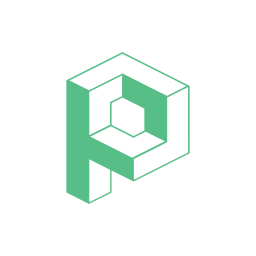

# Polytweaks for Claude

Keep your 3D models, revisions and feedback together. Polytweaks connects Claude to your own model library so you can find saved work, retrieve available source files, save a requested revision, collect comments and create web or AR presentation links.

**Release candidate 0.1.0 — not yet listed in the Claude directory.** This public repository contains the distribution package for review. Building or installing it does not activate its server. A released server, configured OAuth client and successful live acceptance run are required before general use.

[Claude setup guide](https://www.polytweaks.com/help/claude/) · [Public package source](https://github.com/nextlatam/polytweaks-claude). The setup page is part of the candidate service release and may not be available until that release is published.

## What you can do

- Find a model, select an earlier version and retrieve its available GLB, Blender and USDZ files.
- Save a real GLB as a private model, or append a revision while retaining earlier versions.
- Keep a real packed Blender source, authored USDZ and model thumbnail alongside the matching GLB.
- Read comments and post feedback or replies when requested.
- Create separate view-only, review or AR links, with downloads off unless you request them.

Creation and editing use the authoring tools actually available in your Claude session. This plugin does not bundle Blender or a 3D generator. Saved models open in the Polytweaks web viewer; this version does not provide an embedded Claude viewer or an unsaved-preview tool. iOS AR needs an authored USDZ companion.

## Connect after release

In Claude, add the Polytweaks plugin, open its **Connectors** tab and connect Polytweaks. Sign in on Polytweaks and authorize your own account; it may use a different email from your Claude account. Never paste your password, access token or a developer client secret into the conversation.

This release targets Claude chat on web, Desktop and mobile, and Cowork, subject to successful testing on each surface. **Claude Code account authorization is not supported by this release.** Its native OAuth client requires an additional integration even though it can read these skill files.

For a private acceptance run, upload the ZIP through **Customize → Plugins → Add → Upload plugin**. A test administrator must first configure the controlled connector's OAuth client through Claude's secure settings. The public directory will supply the configured connector after approval; installing the ZIP alone cannot supply confidential credentials.

Try: “Find my models in Polytweaks and show the latest version of the one named Chair.” A successful empty library is a valid connection. To start, upload a GLB using the Polytweaks web app.

## File transfer and authoring

The save tool accepts actual direct HTTPS file downloads from hosts approved by Polytweaks. A Claude attachment, local path, sandbox link or file-viewer page is not automatically a downloadable URL. If the session cannot supply an accepted download, use the normal Polytweaks web upload and continue with the saved model in Claude. The plugin never publishes a private file elsewhere to create an upload URL.

Blender-authored work should keep its editable `.blend` with packed resources, matching GLB and authored USDZ in the same asset version. A Blender import of another source is an editable conversion, not an original Blender source. Missing companions remain explicit. Existing versions are preserved.

Example requests after connection:

- “Find Chair, show its versions and get the files available for editing version 2.”
- “Save this GLB as the next version of Chair. Keep earlier versions.”
- “Create a view-only link for Chair with downloads off.”
- “Create a separate review link for Chair so my team can comment. Do not send it.”
- “Show the comments on Chair and add this reply: I will check the dimensions.”
- “Create an AR link for the latest Chair version lasting 24 hours.”

## Access, data and privacy

The package contains instructions, a logo and one remote connector definition. It installs no executable, hook, dependency or background task. Its only declared service connection is the Polytweaks MCP endpoint. OAuth runs between Claude and Polytweaks; each user grants access to their own account. The connector requests model read/write, comment read/write and share creation permissions. Polytweaks enforces account permissions on every action.

Tool calls send the model identifiers, metadata, comment text, sharing choices and file descriptors needed for the requested action to Polytweaks. For a save, Polytweaks fetches the supplied approved file URL and stores the model and requested companions. Results returned to Claude can include model names, version metadata, comments, short-lived private downloads and requested public links. Opening a viewer or downloading a returned file also contacts its Polytweaks delivery service. The package does not independently send data to an analytics service or a model-generation provider.

Saving is private. Creating a share link grants access to its recipients according to the returned permissions and expiry; it does not send the link to anyone. Account content remains in Polytweaks until handled under its retention and closure policy. Disconnect the connector in Claude and revoke its grant in the Polytweaks **Claude integration** settings to end access. Removing skill instructions alone does not revoke a connection or delete models.

Polytweaks is for adults aged 18 or older. Existing account limits apply; this plugin does not process payments or start subscriptions. See the [privacy policy](https://www.polytweaks.com/privacy/), [terms of service](https://www.polytweaks.com/terms-and-conditions/) and [help](https://www.polytweaks.com/public/faq/). Support: [arturo.marruffo@nextlatam.com](mailto:arturo.marruffo@nextlatam.com).

## Package license

The skill instructions, manifests and accompanying documentation are [MIT licensed](LICENSE). This grant does not cover the Polytweaks backend, hosted service, customer models, third-party materials or Polytweaks trademarks and logo. The bundled logo identifies the Polytweaks connection; it does not grant rights to represent an unrelated product as Polytweaks.
